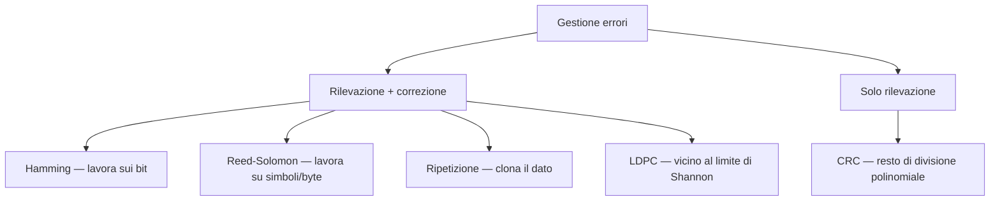
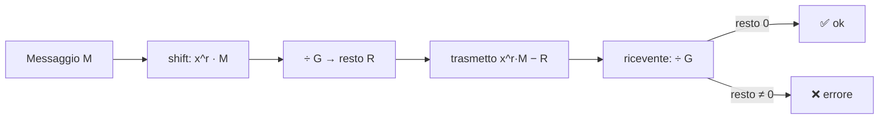

# 🛡️ Codici di correzione errori (Reed-Solomon, CRC, LDPC)

← [[Reti di Calcolatori|Indice del corso]]

> [!info] Lezione del 19 Novembre
> Dopo **Hamming** (già visto), si passa ai codici usati quando la trasmissione è difficile: comunicazioni **spaziali** (potenza di calcolo limitata, migliaia di km di distanza), CD, TV digitale, QR code.

## Reed-Solomon (RS)

Basato sull'**aritmetica polinomiale**: i bit di parità vengono calcolati in base al **resto di una divisione polinomiale**.

$$RS(n, k) \quad \text{→ } n \text{ simboli trasmessi, di cui } k \text{ di dati e } n-k \text{ di ridondanza}$$

Può correggere fino a $\dfrac{n-k}{2}$ simboli errati.

- A differenza di **Hamming**, che lavora sui **bit**, RS può scegliere l'unità base: **byte o gruppi di byte** (simboli)
- Ottimo contro gli **errori di burst** (tanti bit consecutivi sbagliati): nei CD corregge burst fino a **~4000 bit**
- Oltre agli errori di trasmissione gestisce anche le **erasures** (cancellature nette), es. un **graffio** sul CD

> [!tip] Errore vs cancellazione
> È **meglio** avere una cancellazione che un errore di trasmissione: nella cancellazione **sappiamo già dove** manca il dato, quindi RS ne corregge il doppio rispetto agli errori "nascosti".

### Dove si usa

| Applicazione | Codice | Note |
|---|---|---|
| **CD** | RS | corregge l'usura/graffi del disco → la canzone suona comunque |
| **TV digitale** (DVB) | $RS(204,188)$ | ogni 204 byte del flusso, **188 sono dati** e **16 di controllo** |
| **NASA / spazio** | $RS(255,223)$ | standard storico per le sonde → ~87% di data rate utile |
| **QR code** | RS | livelli L, M, Q, H |

> [!warning] Nota sui numeri
> Negli appunti di lezione compare "RS(255,233) → 91%". Lo standard CCSDS/NASA classico è **RS(255,223)** (223/255 ≈ 87,5%); 233/255 ≈ 91%. Verifica sulle slide quale ha usato il prof.

Rispetto al CRC, RS non è definito solo dal **grado** del polinomio: si possono scegliere anche i **coefficienti** (simboli, non solo 0/1).

### QR code

Quando si genera un QR code si sceglie il livello di **error recovery**:

| Livello | Recupero |
|---|---|
| **L** (Low) | ~7% |
| **M** (Medium) | ~15% |
| **Q** (Quartile) | ~25% |
| **H** (High) | ~30% |

> [!example] Perché un biglietto graffiato funziona ancora
> RS non solo trova l'errore ma lo **corregge**. Per questo esiste la **QR code art**: si "rovina" volontariamente parte del codice con un disegno e RS lo ricostruisce comunque.

## Codici a ripetizione

Consistono nel **clonare** il dato trasmesso più volte → molto **sicuri**, ma molto **pesanti** (data rate utile crolla).

## Shannon e il limite della correzione

Lo stesso Shannon del limite di capacità ([[Segnali, banda e teoremi (Fourier, Nyquist, Shannon)]]) ha dimostrato che aumentando la forza di correzione **il data rate non tende a 0**, ma resta un **valore finito** (la capacità del canale).

> [!success] Conseguenza
> Questo ha aperto un mondo per chi sviluppa codici di rilevazione e correzione: esiste un obiettivo raggiungibile. Ad oggi **non ci siamo ancora del tutto vicini**.

### Codici che si avvicinano al limite: LDPC

**LDPC** — *Low Density Parity Check*: si può immaginare come una piccola **rete** (simile a una rete neurale) che dai bit ricevuti produce in output i bit corretti, tramite tanti controlli di parità sparsi.

- **Decoding molto lento** (iterativo)

> [!warning] Non esistono pasti gratis
> Anche se possiamo aumentare la potenza del codice limitando il data rate perso, migliorando qualcosa **qualcos'altro peggiora**: il costo si ripercuote sul **tempo** di applicazione del codice e sulla **memoria**.

## CRC — Cyclic Redundancy Check

Codice simile a RS ma **più semplice**: **rileva** l'errore ma **non lo corregge**.

### Stringa binaria → polinomio

Ogni `1` in posizione $i$ diventa $x^i$:

$$1011 = x^3 + x + 1 \qquad (x^2 \text{ manca perché quel bit è } 0)$$

### Come funziona

1. Si sceglie un **polinomio generatore** $G(x)$ di grado $r$
2. Si **shifta a sinistra** il messaggio $M(x)$ moltiplicandolo per $x^r$ (si libera spazio per il resto)
3. Si calcola il **resto** $R(x)$ della divisione $x^r M(x) / G(x)$
4. Si trasmette $T(x) = x^r M(x) - R(x)$ (in aritmetica mod 2, sottrarre = sommare = XOR)
5. Il ricevente divide quello che riceve per $G(x)$:
   - resto $= 0$ → tutto ok
   - resto $\neq 0$ → **errore di trasmissione**

### Tipologie

Il nome indica il **grado** del polinomio generatore: **CRC-5** ha generatore di grado 5.

- **CRC-32** → compressori (**.zip**), **PNG**, **Ethernet**, trasporto dati su **fibra ottica**

## Collegamenti
- [[Livello data-link (controllo di flusso, Stop and Wait)]] — il livello che usa questi codici
- [[Televisione digitale e satellitare]] — RS(204,188) nel DVB
- [[Segnali, banda e teoremi (Fourier, Nyquist, Shannon)]] — il limite di Shannon
- [[Glossario e formulario]]
