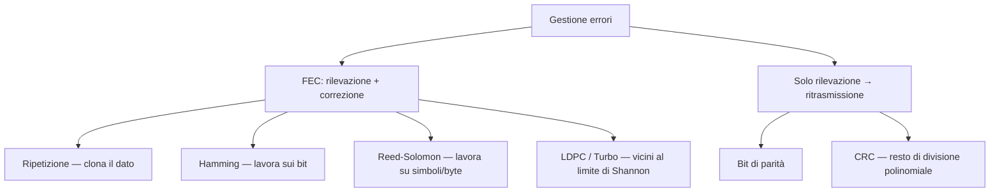
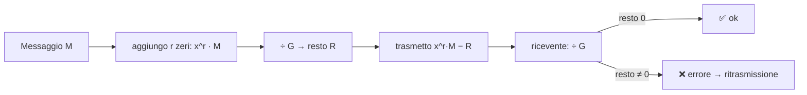

# 🛡️ Codici di correzione errori (Reed-Solomon, CRC, LDPC)

← [[Reti di Calcolatori|Indice del corso]]

> [!info] Lezione del 19 Novembre
> Dopo **Hamming**, si passa ai codici usati quando la trasmissione è difficile: comunicazioni **spaziali** (poca potenza di calcolo a bordo, migliaia di km di distanza, segnale debolissimo), **CD**, **TV digitale**, **QR code**. Sono tutti strumenti del [[Livello data-link (controllo di flusso, Stop and Wait)|livello data-link]] (e in parte del livello fisico).
>
> Le sezioni marcate **📎 Approfondimento** non sono negli appunti di lezione: servono a capire meglio e a rispondere a domande d'esame "di contorno".



## Concetti base

> [!abstract] Correggere o rilevare?
> - **Correzione (FEC, Forward Error Correction)**: il ricevente ricostruisce da solo il dato giusto. Conviene quando **ritrasmettere è costoso o impossibile**: sonde spaziali (ore di ritardo), CD (il disco non può "rimandare"), TV broadcast (nessun canale di ritorno), canali wireless rumorosi.
> - **Rilevazione + ritrasmissione (ARQ)**: il ricevente si accorge solo che c'è un errore e chiede di rimandare. Conviene su canali **affidabili** (fibra, rame), dove gli errori sono rari: costa meno ridondanza.

Un **codeword** di $n$ bit contiene $k$ bit di dati + $r = n - k$ bit di ridondanza.

$$\text{code rate} = \frac{k}{n} \qquad \text{(frazione di bit "utili")}$$

### 📎 Approfondimento — distanza di Hamming

La **distanza di Hamming** tra due codeword è il numero di bit in cui differiscono (si calcola con lo XOR e si contano gli `1`): $10001001 \oplus 10110001 = 00111000$ → distanza **3**.

La **distanza minima** $d$ del codice (tra tutte le coppie di codeword valide) decide la sua potenza:

| Obiettivo | Serve distanza |
|---|---|
| **rilevare** $e$ errori | $d \geq e + 1$ |
| **correggere** $e$ errori | $d \geq 2e + 1$ |

> [!example] Intuizione
> Con $d = 3$, un errore singolo lascia il codeword ricevuto a distanza 1 dall'originale e almeno 2 da tutti gli altri → si sceglie il più vicino. Con 2 errori però si "scivola" verso il codeword sbagliato.

## Codici a ripetizione

Consistono nel **clonare** il dato trasmesso: ogni bit viene mandato 3 volte (`1` → `111`) e il ricevente decide **a maggioranza**.

- Molto **sicuro** e semplicissimo da decodificare
- Molto **pesante**: con 3 ripetizioni il code rate è $1/3$ (il 67% della banda è ridondanza) e corregge solo **1** errore ogni 3 bit ($d = 3$)

## Hamming (ripasso)

> [!note] 📎 Ripasso — Hamming (7,4)
> Inventato da **Richard Hamming** (Bell Labs, 1950). I bit di parità stanno nelle posizioni **potenze di 2** (1, 2, 4, …), i dati nelle altre. Ogni bit di parità controlla le posizioni che hanno quel bit acceso nel loro indice binario.
>
> Dati `1011` → posizioni 3, 5, 6, 7 → codeword **`0110011`**.
>
> Se arriva con il bit 6 sbagliato, ricalcolando le parità i controlli falliti sono quelli di peso 2 e 4 → **sindrome = 2 + 4 = 6** → il bit sbagliato è il **6**, basta invertirlo.
>
> Numero di bit di controllo $r$ per correggere 1 errore su $m$ bit di dati: $(m + r + 1) \leq 2^r$.
>
> **Limite:** corregge **un solo bit** per codeword → inadatto agli **errori di burst**.

## Reed-Solomon (RS)

Ideato da **Irving Reed e Gustave Solomon** (1960). Basato sull'**aritmetica polinomiale**: i simboli di parità si ottengono dal **resto di una divisione polinomiale**, come nel CRC, ma con coefficienti che sono **simboli interi** (di solito byte) e non solo 0/1.

$$RS(n, k): \quad n \text{ simboli trasmessi} = k \text{ di dati} + (n - k) \text{ di parità}$$

$$\text{corregge fino a } t = \frac{n-k}{2} \text{ simboli errati}$$

- A differenza di **Hamming**, che lavora sui **bit**, RS lavora su **simboli**: byte o gruppi di bit
- Con simboli da 8 bit la lunghezza massima è $n = 2^8 - 1 = 255$ → per questo compare spesso **255**

> [!tip] Perché RS è perfetto per i burst
> Un simbolo con **8 bit sbagliati** conta come **un solo errore**. Un burst di 20 bit consecutivi tocca al massimo 4 byte → RS lo vede come 4 errori, non 20. Hamming andrebbe in crisi.

### Errori vs cancellazioni (erasures)

RS gestisce anche le **erasures**: cancellature nette in cui il ricevente **sa dove** manca il dato (es. un **graffio** sul CD, un pacchetto perso).

> [!success] Perché una cancellazione è "meglio" di un errore
> Per un errore il codice deve **trovare** la posizione **e** il valore giusto; per una cancellazione la posizione è già nota, va trovato solo il valore. Infatti, con $e$ errori ed $s$ cancellazioni, RS corregge tutto finché:
> $$2e + s \leq n - k$$
> → riesce a recuperare **il doppio** delle cancellazioni rispetto agli errori.

### Dove si usa

| Applicazione | Codice | Dettagli |
|---|---|---|
| **CD audio** | CIRC (due RS intrecciati + interleaving) | corregge burst fino a **~4000 bit** (~2,5 mm di traccia graffiata); oltre, il lettore **interpola** le note |
| **TV digitale** (DVB, vedi [[Televisione digitale e satellitare]]) | $RS(204,188)$ | ogni pacchetto MPEG-TS da **188 byte** di dati riceve **16 byte** di parità → corregge **8 byte** sbagliati per pacchetto |
| **NASA / spazio** (Voyager, CCSDS) | $RS(255,223)$ | 32 byte di parità, corregge 16 byte; code rate $223/255 \approx 87{,}5\%$ |
| **QR code** | RS | livelli L, M, Q, H |
| Anche… | RS | DVD, Blu-ray, RAID 6, DSL, codici a barre 2D |

> [!warning] Nota sui numeri della lezione
> Negli appunti compare "RS(255,233) → 91%". Lo standard NASA/CCSDS classico è **RS(255,223)** ($223/255 \approx 87{,}5\%$); il 91% corrisponde a $233/255$. Controlla sulle slide quale numero ha usato il prof.

### QR code

Quando si genera un QR code si sceglie il livello di **error recovery**:

| Livello | Recupero | Uso tipico |
|---|---|---|
| **L** (Low) | ~7% | codici puliti, massima capacità |
| **M** (Medium) | ~15% | default più comune |
| **Q** (Quartile) | ~25% | ambienti "sporchi" |
| **H** (High) | ~30% | logo sopra il codice, QR art |

Più alto è il livello, **meno dati** ci stanno nel QR (a parità di dimensione): è il solito compromesso ridondanza ↔ capacità.

> [!example] Perché un biglietto graffiato funziona ancora
> RS non solo trova l'errore ma lo **corregge**. Per questo esiste la **QR code art**: si "rovina" volontariamente parte del codice (o ci si mette un logo al centro) e RS lo ricostruisce comunque.

## Shannon e il limite della correzione

Lo stesso Shannon della formula della capacità ($C = B\log_2(1+S/N)$, vedi [[Segnali, banda e teoremi (Fourier, Nyquist, Shannon)]]) ha dimostrato nel **1948** il *teorema della codifica di canale*:

> [!success] Il risultato
> Finché si trasmette a un rate **inferiore alla capacità $C$**, esistono codici che rendono la probabilità d'errore **piccola a piacere**. Quindi aumentando la forza di correzione **il data rate non tende a 0** (come succederebbe ripetendo il dato all'infinito), ma resta un **valore finito**: $C$.
>
> Shannon però ha dimostrato che questi codici **esistono**, non **come costruirli** → ha aperto un mondo per chi progetta codici di rilevazione e correzione. Per decenni i codici pratici sono rimasti lontani dal limite (**non ci siamo ancora del tutto**, anche se oggi ci si arriva molto vicino).

### Codici che si avvicinano al limite

**LDPC — Low Density Parity Check**
- Inventati da **Robert Gallager** nel **1960**, dimenticati perché troppo pesanti per i computer dell'epoca, riscoperti negli anni '90
- Ogni bit di parità controlla **pochi** bit di dati (matrice di parità **sparsa**, "low density")
- Si può rappresentare come un **grafo** (simile a una piccola **rete neurale**) tra nodi-bit e nodi-controllo: i nodi si scambiano "opinioni" su quanto è probabile che un bit sia 0 o 1, finché non convergono → in output escono i bit corretti
- **Decoding lento** perché **iterativo** (molti giri di scambio di messaggi)
- Usati oggi in **Wi-Fi** (802.11n/ac/ax), **5G** (canali dati), **DVB-S2** (TV satellitare), **10 Gbit Ethernet** su rame

> [!note] 📎 Approfondimento — altri codici "moderni"
> - **Turbo code** (1993): due codificatori in parallelo con interleaving, decodifica iterativa → usati in 3G/4G e dalle sonde spaziali
> - **Polar code** (2009): primi a raggiungere *provabilmente* la capacità → usati nei canali di controllo del **5G**

> [!warning] Non esistono pasti gratis
> Anche se possiamo aumentare la potenza del codice limitando il data rate perso, migliorando qualcosa **qualcos'altro peggiora**: il costo si scarica su **tempo** di codifica/decodifica (latenza), **memoria** e **potenza di calcolo** (e quindi batteria).

## CRC — Cyclic Redundancy Check

Concettualmente parente di RS ma **più semplice**: **rileva** l'errore ma **non lo corregge** → dopo, il livello data-link chiede la **ritrasmissione** del frame.

Non lavora sul messaggio "come numero" né bit per bit: tratta la stringa di bit come un **polinomio**.

### Stringa binaria → polinomio

Ogni `1` in posizione $i$ (contando da destra, partendo da 0) diventa $x^i$:

$$1011 = 1\cdot x^3 + 0\cdot x^2 + 1\cdot x + 1 = x^3 + x + 1$$

L'aritmetica è **modulo 2**: niente riporti, **somma = sottrazione = XOR**.

### Come funziona

Mittente e ricevente si accordano su un **polinomio generatore** $G(x)$ di grado $r$.

1. **Shift**: si moltiplica il messaggio $M(x)$ per $x^r$ → si aggiungono $r$ zeri a destra (si fa spazio al resto)
2. **Divisione**: si divide $x^r M(x)$ per $G(x)$ e si tiene il **resto** $R(x)$ ($r$ bit)
3. **Trasmissione**: $T(x) = x^r M(x) - R(x)$ → in pratica si **sostituiscono gli $r$ zeri con il resto**. Ora $T(x)$ è divisibile esattamente per $G(x)$
4. **Verifica**: il ricevente divide il frame ricevuto per $G(x)$:
   - resto $= 0$ → frame accettato ✅
   - resto $\neq 0$ → **errore di trasmissione** ❌ → scarta il frame



### Esempio svolto

> [!example] Messaggio `1101011111`, generatore `10011` ($x^4 + x + 1$, grado $r = 4$)
> 1. Aggiungo 4 zeri: `11010111110000`
> 2. Divido per `10011`: scorro da sinistra e, ogni volta che trovo un `1` in testa, ci metto sotto il generatore e faccio XOR:
> ```
> 11010111110000
> 10011              XOR
> ──────────────
> 01001111110000
>  10011             XOR
> ──────────────
> 00000011110000
>       10011        XOR
> ──────────────
> 00000001101000
>        10011       XOR
> ──────────────
> 00000000100100
>         10011      XOR
> ──────────────
> 00000000000010     → resto = ultimi 4 bit = 0010
> ```
> 3. Trasmetto **`1101011111` `0010`** = `11010111110010`
> 4. Il ricevente divide `11010111110010` per `10011` → resto `0000` ✅

### Cosa rileva (con un buon generatore di grado $r$)

- **Tutti** gli errori su **un singolo bit**
- **Tutti** gli errori con un **numero dispari** di bit, se $G(x)$ ha il fattore $(x + 1)$
- **Tutti** i **burst** lunghi $\leq r$ bit
- Burst più lunghi con probabilità altissima: sfugge solo circa $1$ su $2^r$ (con CRC-32: 1 su ~4 miliardi)

### Tipologie

Il nome indica il **grado** del polinomio generatore: **CRC-5** ha generatore di grado 5 → 5 bit di controllo.

| Codice | Dove |
|---|---|
| **CRC-5** | pacchetti token **USB** |
| **CRC-16** (CCITT: $x^{16}+x^{12}+x^5+1$) | Bluetooth, HDLC, X.25 |
| **CRC-32** | **Ethernet** (campo FCS del frame), **.zip**, **PNG**, gzip, SATA, trasporto su **fibra ottica** |

> [!warning] Il CRC non è sicurezza
> Il CRC protegge da errori **casuali**, non da modifiche **intenzionali**: un attaccante può alterare i dati e ricalcolare il CRC. Per l'integrità "contro qualcuno" servono gli hash crittografici (SHA-256, MAC).

## Collegamenti
- [[Livello data-link (controllo di flusso, Stop and Wait)]] — il livello che usa questi codici (CRC → ritrasmissione)
- [[Televisione digitale e satellitare]] — RS(204,188) nel DVB
- [[Segnali, banda e teoremi (Fourier, Nyquist, Shannon)]] — il limite di Shannon
- [[Satelliti (LEO, MEO, GEO)]] — perché nello spazio serve la FEC
- [[Glossario e formulario]]
