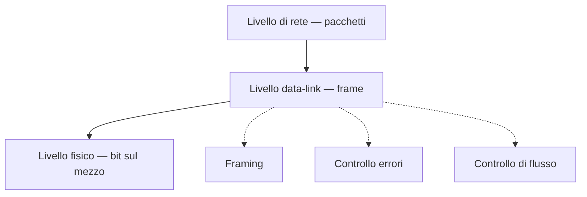
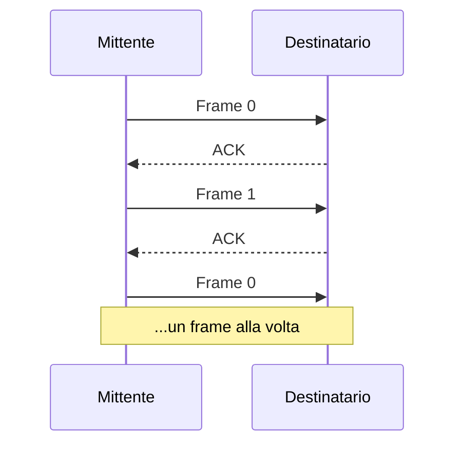
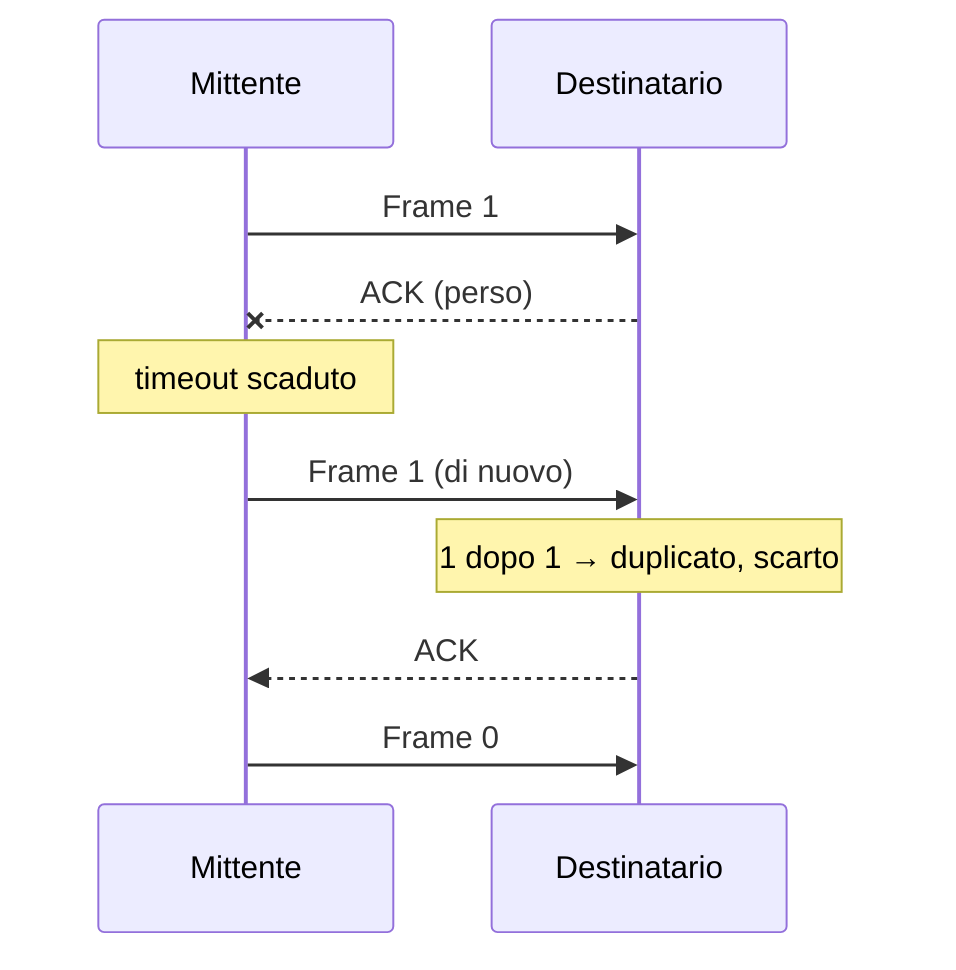

# 🔗 Livello data-link — controllo di flusso, Stop and Wait, Piggybacking

← [[Reti di Calcolatori|Indice del corso]]

> [!info] Lezione del 20 Novembre
> Il livello data-link **gestisce gli errori** (con i codici visti in [[Codici di correzione errori (Reed-Solomon, CRC, LDPC)]]) ma si occupa anche dei **flussi di dati**.
>
> Le sezioni marcate **📎 Approfondimento** non sono negli appunti di lezione: servono a contestualizzare.

## Dove si trova e cosa fa

Il data-link sta **sopra il livello fisico** (che manda bit grezzi su un mezzo, vedi [[Segnali, banda e teoremi (Fourier, Nyquist, Shannon)]]) e **sotto il livello di rete**. Lavora su un **singolo collegamento** tra due macchine **adiacenti** e trasforma un canale di bit "sporco" in un canale di **frame** affidabile.

I tre compiti principali:

| Compito | Domanda a cui risponde |
|---|---|
| **Framing** | dove inizia e dove finisce ogni frame nel flusso di bit? |
| **Controllo errori** | il frame è arrivato integro? se no, come lo recupero? |
| **Controllo di flusso** | il ricevente riesce a stare dietro al mittente? |

> [!note] 📎 Approfondimento — framing
> Il livello fisico consegna solo un flusso continuo di bit: per delimitare i frame si usa ad esempio un **byte di flag** speciale (`01111110`) all'inizio e alla fine. Se quel pattern compare nei dati, si inserisce un bit/byte extra (**bit stuffing** / **byte stuffing**) per non confonderlo con un vero flag; il ricevente lo toglie.

## Controllo di flusso

Se il mittente è **più veloce** del ricevente (o il ricevente è momentaneamente occupato), i dati in arrivo si accumulano, i buffer si riempiono e i frame vengono **persi**: il canale si **congestiona**. Il controllo di flusso serve a evitarlo.

Il modello prevede che **mittente e destinatario possano parlarsi** (*feedback-based flow control*): quando al destinatario arrivano troppi dati, può chiedere uno **stop** e poi dare il via libera per riprendere.

## Protocollo Stop and Wait

Si invia **un frame** e si aspetta un feedback dal ricevente (**ACK**, *acknowledgement*) prima di inviare il successivo → finché non arriva la conferma **non si manda nient'altro**.

- Il flusso di dati va in una direzione e gli ACK nell'altra, **alternati** → basta un canale **half-duplex**
- Ma la comunicazione diventa **molto lenta**: il mittente passa gran parte del tempo ad aspettare

### Miglioria 1 — ACK solo se il frame è corretto + timeout

L'ACK viene mandato **se e solo se** il frame supera il controllo degli errori (es. il [[Codici di correzione errori (Reed-Solomon, CRC, LDPC)|CRC]] dà resto 0). Se i dati sono sbagliati, il destinatario **fa finta che non sia arrivato nulla** e lo scarta.

Serve quindi un **timeout**: il mittente fa partire un timer quando invia un frame; se scade senza ACK, capisce che il frame non è arrivato (o è arrivato rotto) e lo **reinvia**.

> [!tip] Come scegliere il timeout
> - **Troppo corto** → scade prima che l'ACK possa tornare → ritrasmissioni inutili e duplicati
> - **Troppo lungo** → dopo una perdita si resta fermi a lungo → throughput basso
> - Deve essere almeno **RTT + tempo di elaborazione** del ricevente

> [!note] 📎 Nome tecnico
> Questo schema "ACK positivo + ritrasmissione su timeout" si chiama **ARQ** (*Automatic Repeat reQuest*) o **PAR** (*Positive Acknowledgement with Retransmission*).

### Miglioria 2 — numerazione dei frame

Nuovo problema: se a perdersi è l'**ACK** (non il frame), il mittente va in timeout e reinvia → il destinatario riceve **due volte** gli stessi dati e li passerebbe due volte al livello di rete.

Soluzione: **numerare i frame**. Basta **un solo bit** (0 o 1, alternati), perché l'unica ambiguità è tra un frame e il suo immediato successore.

> [!example] Riconoscere un duplicato
> Frame consecutivi devono avere numero **diverso**. Se ricevo `1` e poi di nuovo `1`, so che è un **duplicato** (l'ACK precedente si era perso) → lo **scarto**, ma **rimando l'ACK**, altrimenti il mittente continuerebbe a ritrasmettere all'infinito.

> [!note] 📎 Nome tecnico
> Lo Stop and Wait con numero di sequenza da 1 bit è noto come **Alternating Bit Protocol**.

### Il limite: l'efficienza

La modalità Stop and Wait crea un **enorme overhead**: il canale resta inattivo per quasi tutto il tempo in cui si aspetta l'ACK.

$$U = \frac{T_{frame}}{T_{frame} + RTT} \qquad \text{con } T_{frame} = \frac{\text{dimensione frame}}{\text{bandwidth}}$$

> [!example] 📎 Esempio — canale satellitare
> Canale a **50 kbit/s**, RTT di **500 ms** (satellite GEO, vedi [[Satelliti (LEO, MEO, GEO)]]), frame da **1000 bit**.
> - Trasmettere il frame richiede $1000 / 50\,000 = 20$ ms
> - Poi si aspetta l'ACK per 500 ms
> - Il mittente è attivo per $20$ ms su $520$ → $U \approx$ **4%**
>
> Il **96%** della capacità del canale viene sprecato.

## Piggybacking

Nelle comunicazioni **bidirezionali** (full-duplex) entrambi mandano dati. Invece di mandare un ACK "nudo" appena ricevo un frame, **attacco l'ACK al prossimo frame di dati** che devo comunque trasmettere all'altro ("a cavalluccio"): basta un campo `ack` nell'header.

- **Vantaggio**: un ACK separato costa un frame intero (header + CRC + tempo di canale); nel piggybacking costa **pochi bit** in un frame che parte comunque
- Funziona bene quando la comunicazione è **equilibrata** (entrambi hanno dati da mandare)
- Se non c'è equilibrio, l'ACK resta in attesa di dati che non arrivano → il mittente va in **timeout** e ritrasmette inutilmente → situazione **piena di timeout**

> [!tip] La soluzione pratica
> Il ricevente aspetta **un tempo limitato** (molto più breve del timeout del mittente): se nel frattempo ha dati da mandare, ci attacca l'ACK; altrimenti manda un **ACK separato**. Per questo è importante fissare **timeout adeguati** da entrambe le parti.

## Il prodotto banda × ritardo

$$BD = \text{bandwidth} \times \text{ritardo}$$

Indica **quanti bit "stanno nel tubo"** contemporaneamente, cioè quanti bit il mittente potrebbe aver già inviato prima che il primo arrivi (o, usando l'RTT, prima che torni il suo ACK).

> [!tip] Perché conta
> Un $BD$ **grande** è tipico dei canali **veloci** e/o **lunghi** (fibra transcontinentale, satelliti): ottimo in teoria, perché il canale può trasportare tantissimi dati. Ma con Stop and Wait e piggybacking c'è **un solo frame in viaggio** alla volta, quindi quasi tutto il "tubo" resta vuoto: più $BD$ è grande, **peggio** funzionano.
>
> Nell'esempio sopra: $50$ kbit/s $\times\ 0{,}5$ s $= 25\,000$ bit in un RTT, ma ne mandiamo solo **1000**.

> [!note] 📎 Anticipazione — sliding window
> La soluzione è permettere al mittente di avere **più frame in viaggio** prima di ricevere gli ACK: i protocolli **a finestra scorrevole** (*sliding window*), con le varianti **Go-Back-N** e **Selective Repeat**. Per riempire il canale serve una finestra di circa $w = 2 \cdot BD + 1$ frame (con $BD$ espresso in frame e calcolato sul ritardo di sola andata). Nell'esempio: $BD = 12{,}5$ frame → $w \approx 26$.

## Collegamenti
- [[Codici di correzione errori (Reed-Solomon, CRC, LDPC)]] — CRC e FEC usati dal data-link
- [[Switching (Circuit, Message, Packet)]]
- [[Satelliti (LEO, MEO, GEO)]] — il caso peggiore per lo Stop and Wait
- [[Glossario e formulario]]
