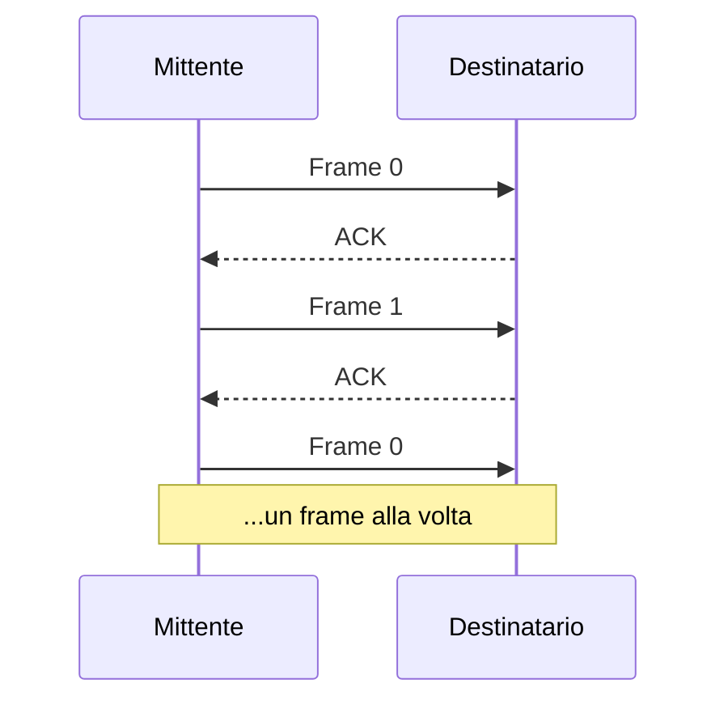
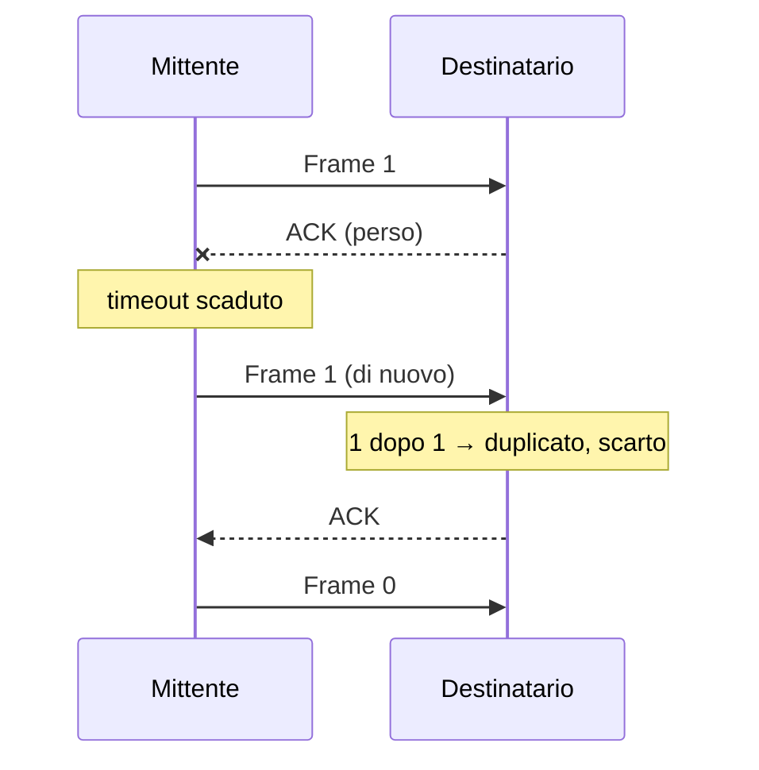

# 🔗 Livello data-link — controllo di flusso, Stop and Wait, Piggybacking

← [[Reti di Calcolatori|Indice del corso]]

> [!info] Lezione del 20 Novembre
> Il livello data-link **gestisce gli errori** (con i codici visti in [[Codici di correzione errori (Reed-Solomon, CRC, LDPC)]]) ma si occupa anche dei **flussi di dati**.

## Controllo di flusso

Se arrivano **troppi dati**, il ricevente (e il canale) si **congestiona**. Il controllo di flusso serve a evitarlo.

Il modello prevede che **mittente e destinatario possano parlarsi**: quando al destinatario arrivano troppi dati, può chiedere uno **stop** e poi far riprendere la comunicazione.

## Protocollo Stop and Wait

Si invia **un frame** e si aspetta un feedback dal ricevente (**ACK**) prima di riprendere → finché non arriva la conferma **non si manda nient'altro**.

- Basta un canale **half-duplex**
- Ma la comunicazione diventa **molto lenta**

### Miglioria 1 — ACK solo se il frame è corretto + timeout

L'ACK viene mandato **se e solo se** il frame supera il controllo degli errori. Se i dati sono sbagliati, il destinatario **fa finta che non sia arrivato nulla**.

Serve quindi un **timeout**: dopo un certo tempo senza ACK, il mittente capisce che il frame non è arrivato e lo **reinvia**.

### Miglioria 2 — numerazione dei frame

Nuovo problema: se è l'**ACK** a perdersi, il mittente reinvia e il destinatario riceve **due volte** gli stessi dati.

Soluzione: **numerare i frame**. Basta un solo bit: **0 o 1**, alternati.

> [!example] Riconoscere un duplicato
> Frame consecutivi devono avere numero **diverso**. Se ricevo `1` e poi di nuovo `1`, so che è un **duplicato** (l'ACK precedente si era perso) → lo scarto, ma rimando l'ACK.

> [!warning] Il limite
> Lo Stop and Wait crea un **enorme overhead** nella comunicazione: il canale resta inattivo per gran parte del tempo, in attesa degli ACK.

## Piggybacking

Invece di mandare un ACK "nudo" appena ricevo un frame, **attacco l'ACK ai dati** che devo comunque trasmettere all'altro ("a cavalluccio").

- Funziona bene quando la comunicazione è **equilibrata** (entrambi hanno dati da mandare)
- Se non c'è equilibrio, l'ACK aspetta dati che non arrivano → situazione **piena di timeout**
- Per questo è importante fissare un **timeout adeguato**

## Il prodotto banda × ritardo

$$\text{bandwidth} \times \text{round-trip delay}$$

Indica **quanti bit "stanno nel tubo"** durante un viaggio di andata e ritorno.

> [!tip] Perché conta
> Quando questo prodotto è **grande** (canali veloci e/o lunghi, es. satelliti — vedi [[Satelliti (LEO, MEO, GEO)]]), Stop and Wait e piggybacking **funzionano male**: si manda un solo frame e poi si aspetta un RTT intero, sprecando quasi tutta la capacità del canale.

## Collegamenti
- [[Codici di correzione errori (Reed-Solomon, CRC, LDPC)]]
- [[Switching (Circuit, Message, Packet)]]
- [[Glossario e formulario]]
