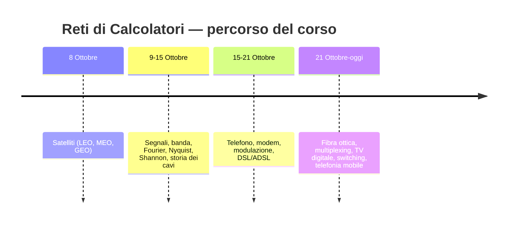
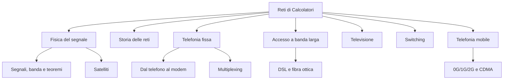

# 🕸️ Reti di Calcolatori — Indice del corso

> [!tip] Come usare questa vault
> Ogni nota è un concetto atomico. Segui i `[[wikilink]]` per muoverti, usa i tag `#RetiDiCalcolatori/...` per vedere tutte le note di un'area nel pannello Tag, e prima dell'esame passa dalla nota [[Domande di autoverifica]] per autoverificarti.

## 📅 Timeline delle lezioni

## 🗂️ Mappa dei concetti

## 📚 Note per argomento

### Fondamenti del segnale
- [[Segnali, banda e teoremi (Fourier, Nyquist, Shannon)]] — ampiezza/frequenza/fase, bit rate vs baud rate, limiti di canale
- [[Satelliti (LEO, MEO, GEO)]] — orbite, fasce di Van Allen, GNSS/GPS

### Storia e infrastruttura
- [[Storia delle reti e dei cavi sottomarini]] — telegrafo, cavi transatlantici, TAT-1/TAT-8

### Telefonia fissa e accesso dati
- [[Dal telefono al modem (modulazione ASK, FSK, PSK, QAM)]] — PSTN, modem, costellazioni
- [[DSL, ADSL, VDSL e fibra ottica (FTTC, FTTB, FTTH)]] — local loop, splitter, PON
- [[Multiplexing (FDM e TDM)]] — divisione di frequenza e di tempo

### Applicazioni e commutazione
- [[Televisione digitale e satellitare]] — QPSK vs QAM, OFDM
- [[Switching (Circuit, Message, Packet)]] — le tre filosofie di commutazione

### Telefonia mobile
- [[Telefonia mobile — 0G, 1G, 2G e CDMA]] — celle, handoff, GSM, SIM, CDMA

### Strumenti per lo studio
- [[Glossario e formulario]] — tutte le formule e i termini chiave in un posto
- [[Domande di autoverifica]] — quiz a scomparsa per il ripasso pre-esame

## 🧭 Filo logico (perché le cose si incastrano)

1. Ogni mezzo fisico ha una **banda limitata** → da qui nascono i teoremi di Nyquist e Shannon ([[Segnali, banda e teoremi (Fourier, Nyquist, Shannon)]]).
2. Per superare i limiti del **local loop** analogico si inventano modulazione e modem ([[Dal telefono al modem (modulazione ASK, FSK, PSK, QAM)]]).
3. Per sfruttare meglio lo stesso cavo nascono **DSL/ADSL/VDSL**, poi si elimina il rame con la **fibra** ([[DSL, ADSL, VDSL e fibra ottica (FTTC, FTTB, FTTH)]]).
4. Per far condividere un canale a più utenti servono le tecniche di **multiplexing** ([[Multiplexing (FDM e TDM)]]), che riappaiono identiche nella telefonia mobile come FDM/TDM/CDMA ([[Telefonia mobile — 0G, 1G, 2G e CDMA]]).
5. Per instradare l'informazione servono strategie di **switching** ([[Switching (Circuit, Message, Packet)]]).
6. I satelliti sono un caso particolare di mezzo trasmissivo con i suoi limiti di potenza/distanza/latenza ([[Satelliti (LEO, MEO, GEO)]]), e tornano anche nella TV ([[Televisione digitale e satellitare]]).
