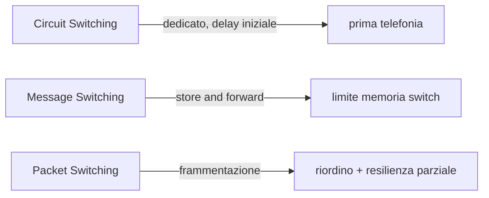

# 🔁 Switching

← [[Reti di Calcolatori|Indice del corso]]

Tre filosofie per instradare l'informazione attraverso una rete:

## Circuit Switching

Collegamento **fisico** tra i due comunicatori → si crea un **circuito dedicato privato**. Tipo usato dalla prima telefonia e dalle prime comunicazioni.

- Presente un **delay iniziale** (tempo per instaurare il circuito)

## Message Switching

Si introducono **switch** dentro la rete: si aspetta che lo switch dica dove instradare effettivamente il messaggio. Chiamato anche **"store and forward"**.

- Riduce il ritardo rispetto al circuit switching
- Problema: il messaggio può essere troppo grande → **limite di memoria dello switch**

## Packet Switching

Si **frammenta** l'informazione (dimensione massima prefissata) e si invia a pacchetti, riducendo il peso rispetto allo switch.

- Problema 1: se un dispositivo di switching si guasta e nessun altro prende il suo posto, l'informazione resta bloccata
- Problema 2: i pacchetti possono arrivare **disordinati**

> [!success] Perché contano gli standard
> Per far funzionare bene il Packet Switching sono nati **standard** per uniformare le telecomunicazioni (base di tutte le reti dati moderne, incluso Internet).

## Collegamenti
- [[Telefonia mobile — 0G, 1G, 2G e CDMA]]
- [[Glossario e formulario]]
