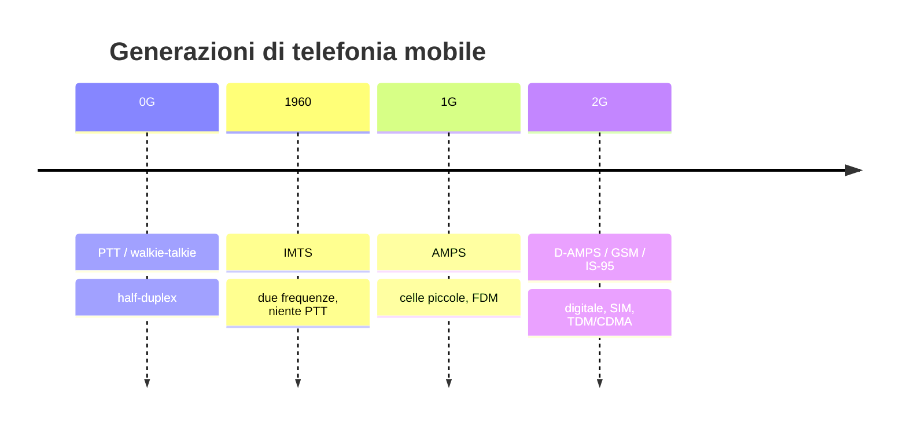

# 📱 Telefonia mobile — 0G, 1G, 2G e CDMA

← [[Reti di Calcolatori|Indice del corso]]

> [!info] Analogico vs digitale
> **0G e 1G** sono analogiche. Da **2G in poi** tutto è digitale.

## 0G

Deriva dalle trasmissioni radio e dal **PTT** (Push To Talk) — walkie-talkie.

- Canale **unico** per ricevere e trasmettere → **half-duplex** (se uno parla, l'altro può solo ricevere)
- Si pagava per ogni volta che si occupava la risorsa (il canale si bloccava per gli altri)

### 1960 — IMTS (Improved Mobile Telephone System)

Si passa a **due frequenze** → non serve più il PTT. Introdotto un sistema di **cifratura** per impedire a terzi di ascoltare (cosa che accadeva col PTT).

Super-trasmettitori (100 km²) ad altissima potenza, centinaia di km, **23 canali** (23 utenti per cella in contemporanea) — troppo limitativo per aree grandi. Si decise quindi di **ridurre le celle** per partizionare meglio gli utenti.

> [!example] Dove si usa ancora
> Il sistema a celle gigantesche è ancora usato in zone remote e poco abitate (es. Canada, nei boschi) per minimizzare i costi.

## 1G

Introdotto **AMPS** (Advanced Mobile Phone System): celle molto più piccole (10–20 km²).

- Più utenti connessi contemporaneamente; trasmettitore più vicino → meno batteria consumata → telefoni più piccoli
- Problema maggiore: **interferenza fra celle** → si separa per **frequenza**: cella X usa Y frequenze diverse, ma così si riduce il numero di frequenze per cella

### Il teorema dei 4 colori

Per capire come dividere celle/frequenze: **Francis Guthrie** (1852) notò che per colorare qualsiasi mappa bastano 4 colori. Dimostrato veramente solo nel **1976** (Teorema dei 4 colori), da 2 matematici **al computer** (1936 casi verificati) — primo problema matematico risolto da un calcolatore.

> [!success] Conseguenza pratica
> Bastano **4 range di frequenza** per coprire tutte le celle della rete senza interferenze adiacenti → prestazioni = **1/4**. Inoltre si sfasano le celle in una **matrice esagonale**.

Con il controllo totale del territorio basterebbero **3** range di frequenze; in pratica si usano **3–7 range** in base a densità di popolazione e necessità di espansione. Quando si annidano celle più piccole dentro celle esistenti (per coprire zone con più bisogno), non bastano più 4 range perché le frequenze sono già "colorate".

### Handoff

Passaggio della chiamata da una cella all'altra.

- Nelle prime tecnologie causava **caduta della linea**
- **Handoff soft**: la cella nuova viene presa prima di essere staccati dalla vecchia → **1G e 2G non la gestiscono** (eccezione: IS-95/CDMA, vedi sotto)

### 1G — funzionamento

Ogni cella gestisce molti utenti con **FDM** (vedi [[Multiplexing (FDM e TDM)]]) → 832 canali possibili, 45 effettivi.

Ogni telefono ha un numero seriale (32 bit) e un numero di telefono (10 cifre). Ogni 15 minuti il telefono fa broadcast di queste info per segnalare alla rete in che cella si trova. Per chiamare si richiede un canale apposito (esistono canali di servizio condivisi e canali privati per le chiamate); per ricevere, un canale pubblico segnala i destinatari — chi vede le proprie info sa che qualcuno vuole parlare.

## 2G

Prima generazione **digitale**. Non c'è un unico standard mondiale — tutto frammentato.

### D-AMPS

Retrocompatibile con 1G, frequenze maggiorate (1850–1990 MHz) → antenne più piccole. **D**igital AMPS: voce digitalizzata e compressa → maggiore capacità del canale.

> [!warning] Compressione a basso consumo
> Non si possono usare algoritmi di compressione "da PC" (batteria insufficiente) → si usano algoritmi ad alta efficienza energetica, es. **modulazione delta** (differenza: la frequenza cresce=1 o sale=0) → perde un po' di dettaglio ma è molto efficiente.

Multiplexing delle comunicazioni compresse: **TDM** → maggiore efficienza, perdita di definizione del suono.

**MAHO** (Mobile Assisted HandOff): dalla 2G, l'handoff è deciso dal **telefono** (non più dal centralino) — se la comunicazione peggiora, il telefono cerca una cella migliore. È collegato alle "tacche" di segnale sui telefoni moderni.

### GSM

Nuovo standard europeo (ETSI), prima rete commerciale in **Finlandia, 1991**. Canali larghi **200 kHz** (vs 30 kHz di AMPS/D-AMPS) → qualità migliore rispetto agli USA.

### SIM

Introdotta nel 2G — **Subscriber Identity Module**. Informazioni principali:

| Campo | Significato |
|---|---|
| **IMSI** | International Mobile Subscriber Identity — unico nel mondo |
| **Ki** | chiave segreta condivisa tra SIM e operatore, per autenticazione e cifratura |

**Autenticazione** (anti-clonazione):
1. Il telefono invia l'**IMSI**
2. L'operatore manda un numero casuale (**RAND**)
3. La SIM combina RAND con **Ki** → restituisce **SRES**
4. L'operatore, con la stessa Ki nel suo database, fa lo stesso calcolo: se i due SRES coincidono, il telefono è autenticato

> [!info] Ki non è una chiave privata
> È un **segreto condiviso**: non viene mai trasmesso in rete.

## CDMA — Code Division Multiple Access

Terzo modo (oltre a FDM e TDM) di far parlare più utenti sullo stesso canale: **divisione per codice**. Tutti trasmettono **contemporaneamente**, su **tutta la banda**, ma ciascuno con un **codice diverso**.

> [!example] Analogia della festa
> In una stanza tutti parlano insieme, ma ognuno in una lingua diversa: capisco solo chi parla la mia lingua, gli altri sono solo rumore di fondo. La lingua = il codice. Senza conoscere il codice, il segnale sembra solo rumore → sicurezza aggiuntiva.

Standard: **IS-95 / cdmaOne** (Qualcomm, 1995, USA) — un 2G, concorrente del GSM in America. Diventa base del 3G (**CDMA2000**, **W-CDMA** nell'UMTS).

### Funzionamento

- Ogni bit si divide in **m chip** (tipicamente 64 o 128); ogni utente ha una **chip sequence** (il suo codice)
- I codici sono matrici di **1 e −1** (matrice **Hadamard**) — notazione **bipolare**: 1 = +1, 0 = −1
- Per mandare **1** → mando il mio codice
- Per mandare **0** → mando il mio codice **negato**
- Se non trasmetto → non mando niente

I codici devono essere **ortogonali**: il prodotto scalare normalizzato tra due codici diversi fa 0.

$$S \cdot T = 0 \ (\text{codici diversi}) \qquad S \cdot S = 1 \qquad S \cdot (-S) = -1$$

Nel canale i segnali **si sommano**. Il ricevitore fa il prodotto scalare col codice di chi vuole ascoltare: **+1** → è stato mandato 1; **−1** → è stato mandato 0; **0** → quell'utente non ha trasmesso. Grazie all'ortogonalità, tutti gli altri utenti si annullano.

#### Esempio (codici a 4 chip)

- A = (+1 +1 +1 +1)
- B = (+1 −1 +1 −1)
- C = (+1 +1 −1 −1)

A manda **1** → (+1 +1 +1 +1); B manda **0** → −B = (−1 +1 −1 +1); C non trasmette.

Segnale nel canale = somma → **S = (0 +2 0 +2)**

| Decodifico | Calcolo | Risultato |
|---|---|---|
| A | (0·1+2·1+0·1+2·1)/4 = 4/4 | **+1** → A ha mandato 1 ✅ |
| B | (0·1−2·1+0·1−2·1)/4 = −4/4 | **−1** → B ha mandato 0 ✅ |
| C | (0·1+2·1−0·1−2·1)/4 = 0 | **0** → C non ha trasmesso ✅ |

### Vantaggi

- **Niente problema dei colori**: con FDM ogni cella doveva usare frequenze diverse dalle vicine (teorema dei 4 colori, prestazioni 1/4). Con CDMA, tutte le celle usano **tutte** le frequenze, cambiano solo i codici → riuso delle frequenze = **1**
- **Soft handoff**: celle vicine usano la stessa frequenza → il telefono può restare collegato a 2 celle contemporaneamente senza far cadere la chiamata (IS-95, eccezione tra i 2G)
- **Resistenza alle interferenze**: segnale "spalmato" su tutta la banda (*spread spectrum*) → un disturbo su una frequenza rovina solo una piccola parte

### Problemi

- **Near-far**: un telefono vicino all'antenna "urla" e copre quelli lontani → serve **controllo di potenza** (nell'IS-95, la stazione base lo aggiorna ~800 volte/secondo) — risparmia anche batteria
- **Sincronizzazione**: i chip di tutti devono arrivare allineati o l'ortogonalità salta (IS-95 si sincronizza via GPS)
- **Più banda richiesta**: più chip per bit (es. m=128 → 128 chip per bit)

### FDM vs TDM vs CDMA

| | Cosa divide | Esempio |
|---|---|---|
| **FDM** | le frequenze | 1G (AMPS) |
| **TDM** | il tempo | 2G (D-AMPS, GSM) |
| **CDMA** | i codici (tutti insieme, tutta la banda) | 2G americano (IS-95), base del 3G |

> [!tip] Un dettaglio sottile
> In CDMA conviene che ogni utente parli con lo stesso "volume": i cellulari regolano la modulazione della voce per restare nel range specifico (collegato al problema near-far).

## Collegamenti
- [[Multiplexing (FDM e TDM)]]
- [[Switching (Circuit, Message, Packet)]]
- [[Dal telefono al modem (modulazione ASK, FSK, PSK, QAM)]]
- [[Glossario e formulario]]
